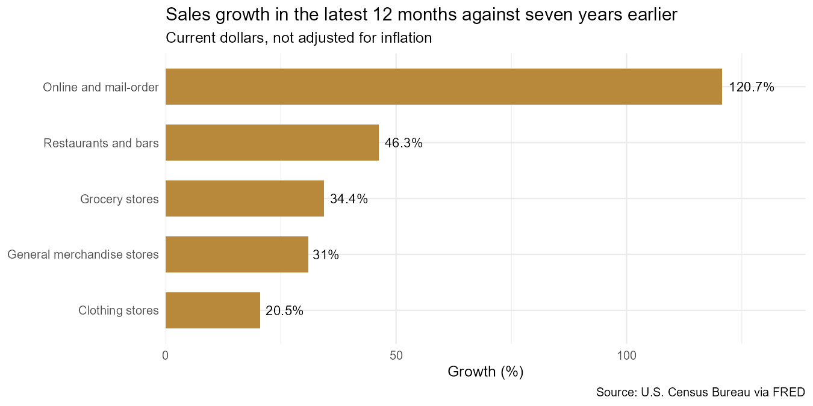
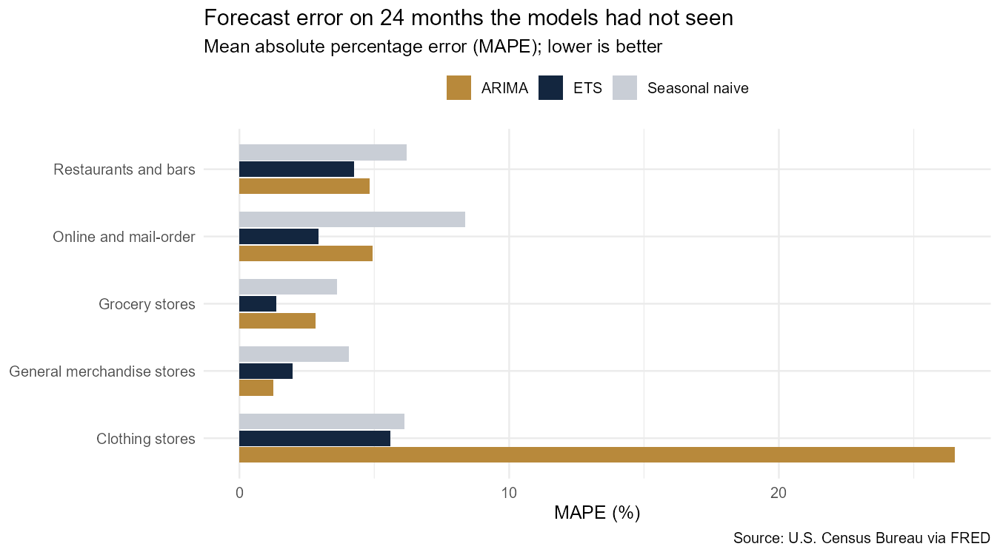
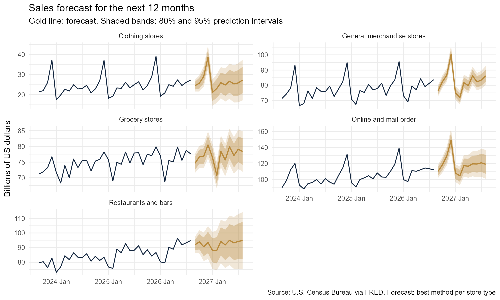

# US retail sales: online keeps growing fastest, and a simple model forecasts within 3%

**US online sales more than doubled between 2019 and 2026 (+121%), while clothing sales fell after inflation. Tested on 24 months it had not seen, an exponential smoothing (ETS) model forecast sales with an average error of 3.2%, against 5.7% for the simple "same month last year" benchmark. For the 12 months to August 2027, it forecasts online sales up 6.7% and grocery almost flat (+0.9%).**

**Tools:** R (tidyverse, tsibble, fable, feasts, ggplot2), Quarto

**Data:** [U.S. Census Bureau, Monthly Retail Trade Survey](https://www.census.gov/retail/index.html), via [FRED](https://fred.stlouisfed.org/); monthly sales for five store types, January 2010 to August 2026, not seasonally adjusted

**Read the full report:** [ayanfedara.github.io/us-retail-forecast/retail_forecast.html](https://ayanfedara.github.io/us-retail-forecast/retail_forecast.html) | **Code:** [`retail_forecast.qmd`](retail_forecast.qmd)

---

## Business question

US retailers plan stock, staff and cash a year ahead. Which store types will grow over the next 12 months, and how far can a forecast be trusted?

## Findings

### 1. Online sales more than doubled since before the pandemic; clothing fell after inflation

Comparing the 12 months to August 2026 with the 12 months to August 2019, online and mail-order sales grew from 609 to 1,344 billion dollars (+121%). Restaurants and bars grew 46%, grocery 34%, general merchandise 31% and clothing 21%. US consumer prices rose about 30% over the same period, so clothing sales fell in real terms and general merchandise only kept pace with inflation.

### 2. Clothing depends most on December

December brought in 13.0% of clothing stores' 2025 sales, against 8.3% for an average month, followed by online (10.9%) and general merchandise (10.2%). Grocery (8.8%) and restaurants and bars (8.4%) barely change through the year.

### 3. ETS was the most accurate method; ARIMA failed for clothing

Each method was trained on January 2010 to August 2024 and forecast September 2024 to August 2026.

| Method | Average error (MAPE) | Best for |
| --- | --- | --- |
| ETS (exponential smoothing) | **3.2%** | Clothing, grocery, online, restaurants and bars |
| Seasonal naive (same month last year) | 5.7% | None |
| ARIMA | 8.1% | General merchandise (1.3%) |

ETS beat the benchmark for all five store types. ARIMA was the most accurate for general merchandise but failed for clothing (26.5% error), most likely because the collapse in clothing sales during the 2020 lockdowns distorted the model. Clothing was the hardest to forecast: even ETS was off by 5.6%, only slightly better than the benchmark (6.1%).

### 4. Online is forecast to grow fastest; grocery to stay almost flat

| Store type | Last 12 months ($bn) | Next 12 months ($bn) | Change | Test error |
| --- | --- | --- | --- | --- |
| Online and mail-order | 1,344 | 1,434 | +6.7% | 2.9% |
| Restaurants and bars | 1,060 | 1,110 | +4.7% | 4.3% |
| General merchandise | 958 | 992 | +3.5% | 1.3% |
| Clothing | 310 | 318 | +2.8% | 5.6% |
| Grocery | 916 | 924 | +0.9% | 1.4% |

Forecast period: September 2026 to August 2027, using the most accurate method for each store type. All figures are in current dollars, so grocery's +0.9% would be a small fall after inflation.

## Recommendation

- **Plan on the grocery and general merchandise forecasts with confidence;** their test errors were under 1.5%.
- **Hold a larger buffer for clothing,** where forecasts were off by about 6% and December alone brings 13% of the year's sales.
- **Use ETS as the default forecasting method,** and keep the seasonal naive benchmark as a check: a method that cannot beat it should not be used.
- **Retest every year** on the latest 24 months, since a shock like 2020 can change which method works best.

## Method

- **Data:** five Census retail series, cut to the latest month all five have (August 2026); sales in billions of current US dollars.
- **Exploration:** growth against the same 12 months seven years earlier; trend and seasonal strength from an STL decomposition; December's share of annual sales.
- **Testing:** the last 24 months held back; seasonal naive, ETS and ARIMA (on log sales) trained on the earlier data and scored by MAPE and MASE on the held-back months.
- **Forecast:** all three methods refitted on the full data; for each store type, the method with the lowest test error forecasts the next 12 months with 80% and 95% prediction intervals.

## Limitations

- Sales are in current dollars, so growth includes price increases.
- Recent months are early estimates that the Census Bureau may revise.
- The models use past sales only and cannot foresee shocks such as a recession, a tariff change or a pandemic.
- The test covers one 24-month period; another period could rank the methods differently.

## How to run it

See [GUIDE.md](GUIDE.md). Download the CSV with the link in the guide into `data/`, open `us-retail-forecast.Rproj` in RStudio, and render `retail_forecast.qmd`.

---

Olorunmaiye Peter | [Portfolio](https://ayanfedara.github.io)
